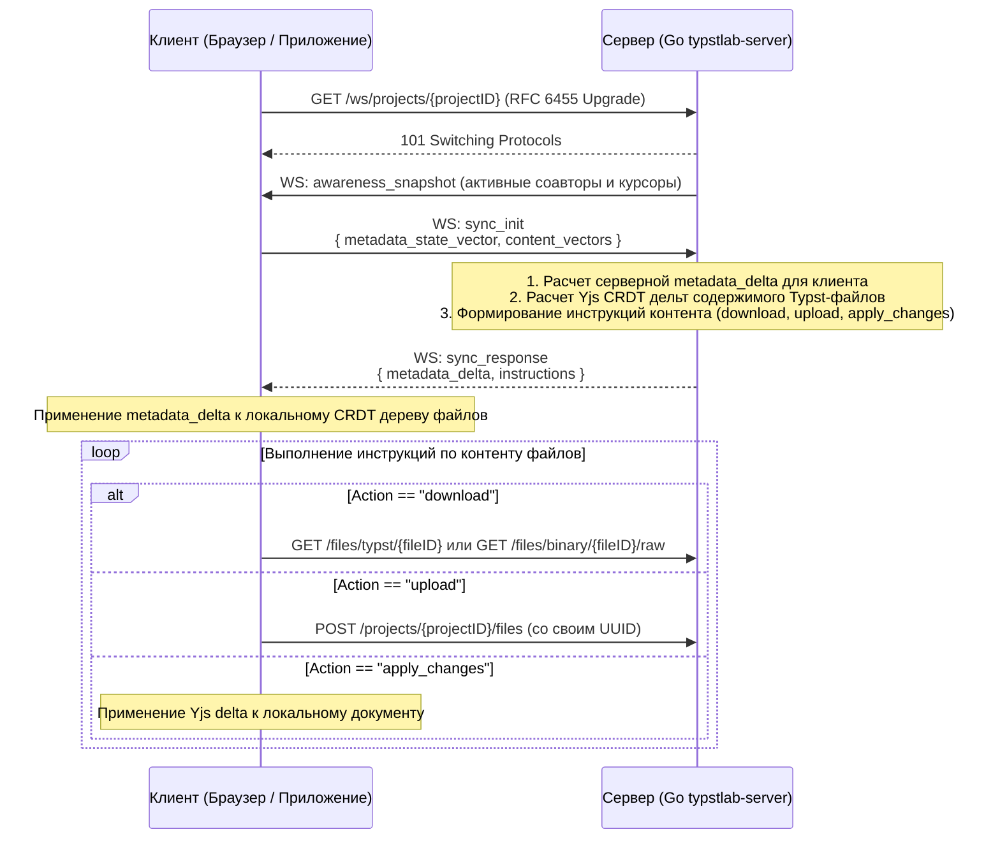

# Спецификация протокола офлайн-синхронизации файлов (Sync Protocol Specification)

Настоящий документ содержит формальное описание архитектуры, протокола взаимодействия, форматов данных и алгоритмов разрешения конфликтов при офлайн-синхронизации файлов в платформе TypstLab.

---

## 1. Общий обзор и архитектура

Для обеспечения синхронизации файлов, созданных или изменённых клиентом в офлайн-режиме, используется двухшаговое рукопожатие («запрос-ответ») через постоянный WebSocket-шлюз (`GET /ws/projects/{projectID}`) при помощи сообщений `sync_init` и `sync_response`.

### Принципы протокола:
1. **Клиентские UUID:** Все уникальные идентификаторы файлов (`id`) генерируются исключительно на стороне клиента (включая офлайн-режим).
2. **CRDT-синхронизация дерева файлов (Metadata):** Имена файлов, структура и статусы удаления синхронизируются через Yjs CRDT метаданных проекта (`metadata_delta` и `metadata_state_vector`) автоматически и бесконфликтно.
3. **CRDT-синхронизация содержимого Typst (Yjs):** Для текстовых файлов Typst клиент передаёт карту векторов состояния `content_vectors` (`fileID -> state_vector`) в сообщении `sync_init`. Сервер вычисляет недостающую дельту и передаёт её клиенту в инструкции `apply_changes` сообщения `sync_response`.
4. **Единый эндпоинт загрузки:** Клиент загружает созданные в офлайне бинарные и Typst-файлы через единый HTTP-метод `POST /projects/{projectID}/files`.
5. **Реалтайм-взаимодействие:** Все последующие правки текста и метаданных передаются через сообщения `crdt_update` и `metadata_update` в том же WebSocket-соединении.

---

## 2. Диаграмма взаимодействия (Sequence Diagram)



---

## 3. Форматы сообщений синхронизации (WebSocket)

### 3.1. Запрос синхронизации клиентов (`sync_init`)

Клиент отправляет JSON-сообщение типа `sync_init`:

```json
{
  "type": "sync_init",
  "payload": {
    "metadata_state_vector": "base64_encoded_state_vector_here",
    "content_vectors": {
      "c30980ef-51eb-47eb-ba05-89416a5db202": "base64_encoded_typst_text_state_vector"
    }
  }
}
```

#### Описание полей payload запроса:
| Поле                    | Тип                        | Обязательность | Описание                                                                  |
|:------------------------|:---------------------------|:--------------:|:--------------------------------------------------------------------------|
| `metadata_state_vector` | `Base64 (string)`          |      Нет       | Вектор состояния метаданных проекта на клиенте.                           |
| `content_vectors`       | `Map<UUID, Base64 string>` |      Нет       | Векторы состояния Yjs для текста Typst-файлов (`fileID -> state_vector`).  |

---

### 3.2. Ответ сервера (`sync_response`)

Сервер отвечает JSON-сообщением типа `sync_response`:

```json
{
  "type": "sync_response",
  "payload": {
    "metadata_delta": "base64_encoded_crdt_delta_here",
    "instructions": [
      {
        "action": "download",
        "file_id": "f5127cd9-4099-4c12-a74e-6e4695e263ab"
      },
      {
        "action": "upload",
        "file_id": "e8a34bc1-443b-417d-8153-f7256561129b"
      },
      {
        "action": "apply_changes",
        "file_id": "c30980ef-51eb-47eb-ba05-89416a5db202",
        "delta": "base64_encoded_crdt_delta_here"
      }
    ]
  }
}
```

#### Описание полей ответа:
| Поле                      | Тип                      | Описание                                                                           |
|:--------------------------|:-------------------------|:-----------------------------------------------------------------------------------|
| `metadata_delta`          | `Base64 (string)`        | Двоичная дельта обновлений CRDT метаданных проекта для применения на клиенте.      |
| `instructions`            | `Array<SyncInstruction>` | Список команд, которые клиент должен выполнить для синхронизации контента файлов.   |
| `instructions[].action`   | `enum`                   | Тип действия: `"download"`, `"upload"`, `"apply_changes"`.                          |
| `instructions[].file_id`  | `UUID (string)`          | Идентификатор файла, к которому относится действие.                                |
| `instructions[].delta`    | `Base64 (string)`        | Двоичная дельта обновлений Yjs (передаётся только для `action: "apply_changes"`).  |

---

## 4. Алгоритм обработки инструкций (`action`)

1. **`metadata_delta`**:
   - Применяется клиентом к локальному CRDT-документу метаданных проекта. Автоматически и бесконфликтно синхронизирует имена файлов (включая бинарные) и статусы удаления.

2. **`download`**:
   - Выдаётся, если файл существует на сервере, но отсутствует в локальном манифесте клиента.
   - Клиент запрашивает контент через `GET /files/typst/{fileID}` или `GET /files/binary/{fileID}/raw`.

3. **`upload`**:
   - Выдаётся, если файл был создан клиентом локально в офлайне и отсутствует на сервере.
   - Клиент отправляет контент и свой UUID на `POST /projects/{projectID}/files`.

4. **`apply_changes`**:
   - Выдаётся для Typst-файлов, если на сервере есть обновления текста, отсутствующие у клиента.
   - Сервер рассчитывает дельту: `crdt.EncodeStateAsUpdateV1(serverDoc, clientStateVector)`.
   - Клиент применяет полученную дельту `delta` к своему локальному Yjs-документу.

---

## 5. Реалтайм-синхронизация через WebSocket (Phase 2)

Для активного взаимодействия соавторов вся синхронизация документов переведена на постоянный WebSocket-шлюз.

### 5.1. Подключение и требования протокола

* **Эндпоинт:** `GET /ws/projects/{projectID}`
* **Аутентификация:** Исключительно через `access_token` cookie (автоматически отправляется браузером при WebSocket handshake). Заголовок `Authorization` и query-параметры не поддерживаются в целях безопасности.
* **Обязательность WebSocket (RFC 6455):** Клиенты без заголовков `Upgrade: websocket`, `Connection: Upgrade`, `Sec-WebSocket-Version: 13` строго отклоняются со статусом **`426 Upgrade Required`**.

### 5.2. Формат конверта сообщений

Все сообщения передаются в виде JSON-конверта:

```json
{
  "type": "<message_type>",
  "payload": { ... }
}
```

### 5.3. Спецификация типов сообщений

| Тип (`type`) | Направление | Описание |
|:---|:---:|:---|
| `sync_init` | Client -> Server | Запрос начальной синхронизации: клиент передает вектор состояния метаданных `metadata_state_vector` и векторы файлов `content_vectors` (`fileID -> state_vector`). |
| `sync_response` | Server -> Client | Ответ начальной синхронизации: сервер возвращает серверную `metadata_delta` и инструкции с дельтами документов (`instructions`). |
| `crdt_update` | Двустороннее | Передача дельты текста Typst-файла (`file_id`, `delta`). Сервер сохраняет дельту и рассылает соавторам с указанием `sender_id`. |
| `metadata_update` | Двустороннее | Передача дельты дерева файлов (`delta`). Сервер объединяет метаданные и рассылает соавторам с `sender_id`. |
| `awareness_snapshot` | Server -> Client | Рассылается новому участнику при подключении: текущий список активных пользователей, их цветов и координат курсоров. |
| `awareness_update` | Двустороннее | Передача координат курсора и выделения (`file_id`, `cursor: {anchor, head}`). Рассылается соавторам. |
| `awareness_remove` | Server -> Client | Рассылается соавторам при отключении участника для удаления его курсора (`user_id`). |
| `ping` / `pong` | Двустороннее | Контроль активности и стабильности канала. |
| `error` | Server -> Client | Сообщение об ошибке обработки (`message`). |


